

  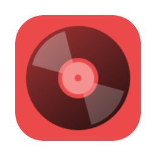

<h1 align="center">Tempus for macOS</h1>

  <b>Your Subsonic music library, native on the Mac</b>

  <a href="https://github.com/Unrefundable/Tempus-For-Mac/releases"><b>Download</b></a> ·
  <a href="#screenshots">Screenshots</a> ·
  <a href="#features">Features</a> ·
  <a href="#installation">Installation</a> ·
  <a href="#building-from-source">Build from source</a> ·
  <a href="#credits">Credits</a>

---

**Tempus for macOS** is an open-source, privacy-focused music client for [Subsonic](https://www.subsonic.org), [OpenSubsonic](https://opensubsonic.netlify.app) and [Navidrome](https://www.navidrome.org) servers, built natively for the Mac in Swift and SwiftUI. It brings the [Tempus](https://github.com/eddyizm/tempus) Android app to the desktop with the same look, icons and features, plus what you'd expect from a Mac app: a sidebar, a menu bar, keyboard shortcuts, media keys and AirPlay.

Like Tempus, it doesn't rely on recommendation algorithms. Home is built from your own listening history, your favorites and a bit of randomness, and plays can be scrobbled to Last.fm or ListenBrainz through your server. Your music and account stay between your Mac and your server: there are no analytics or third-party accounts, and passwords are kept in the macOS Keychain.

> [!NOTE]
> This is an unofficial, community port and isn't affiliated with the Tempus project, which can be found [here](https://github.com/eddyizm/tempus).

> [!IMPORTANT]
> Tempus for macOS is in **beta**. Expect bugs

## Screenshots

  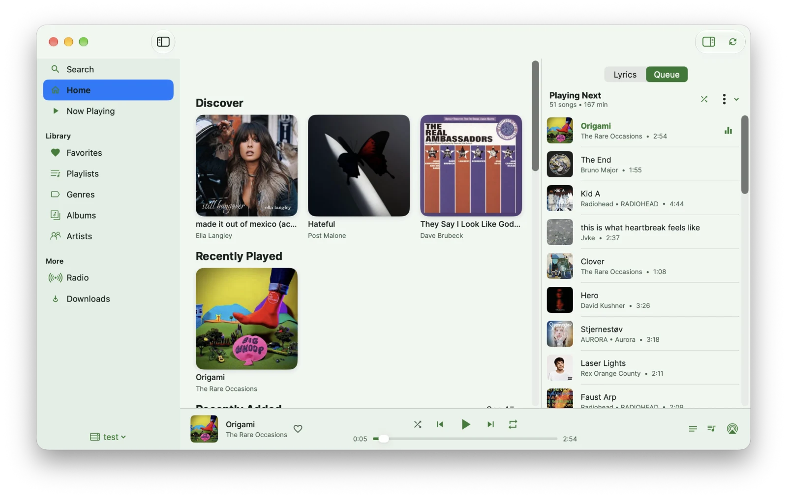
  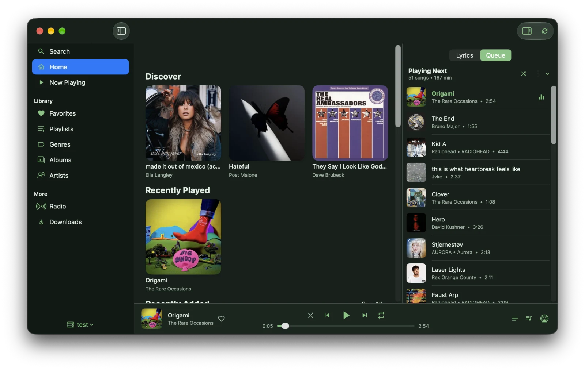

Pick a theme in **Settings › Appearance**. Each theme comes in a light and a dark version.

| Theme | Light | Dark |
|---|---|---|
| **Forest** | 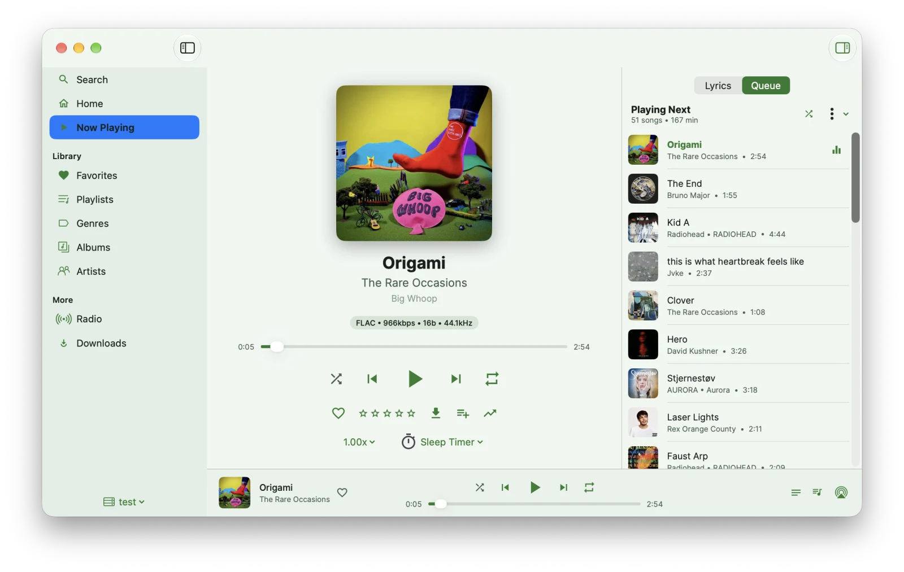 | 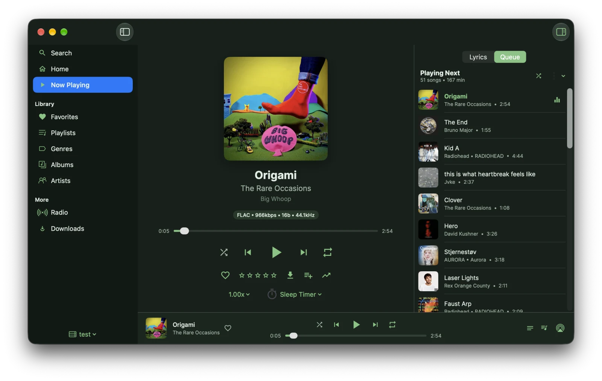 |
| **Midnight** | 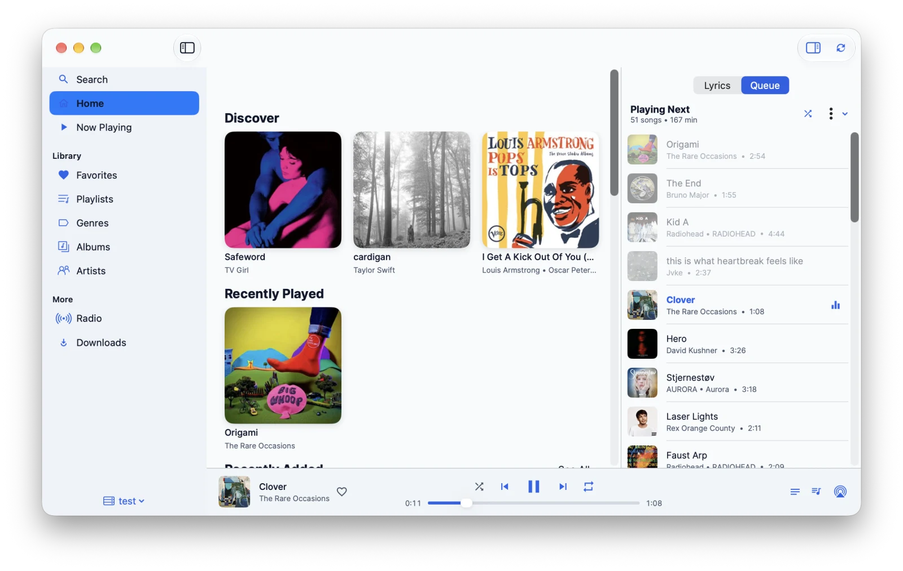 | 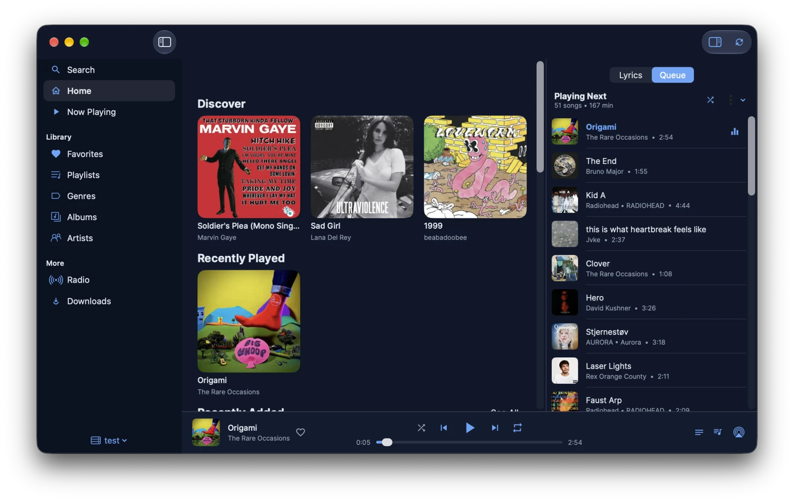 |
| **OLED** | 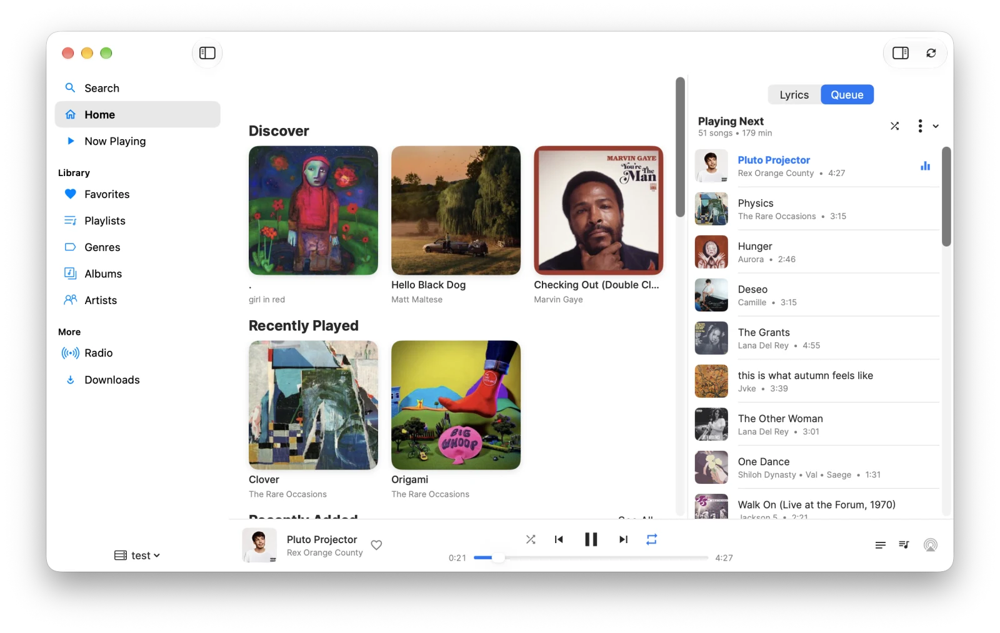 | 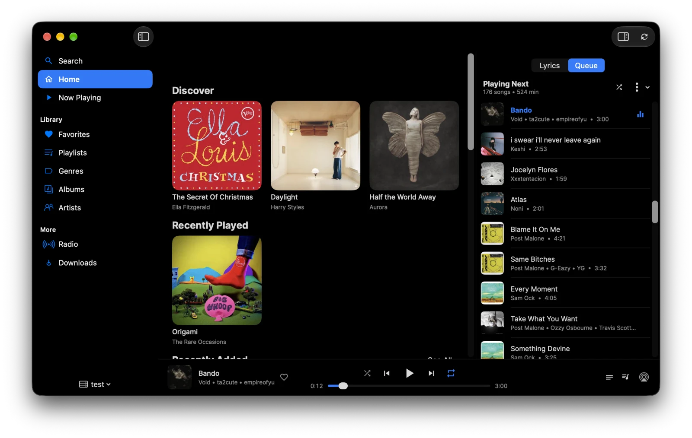 |
| **Sepia** | 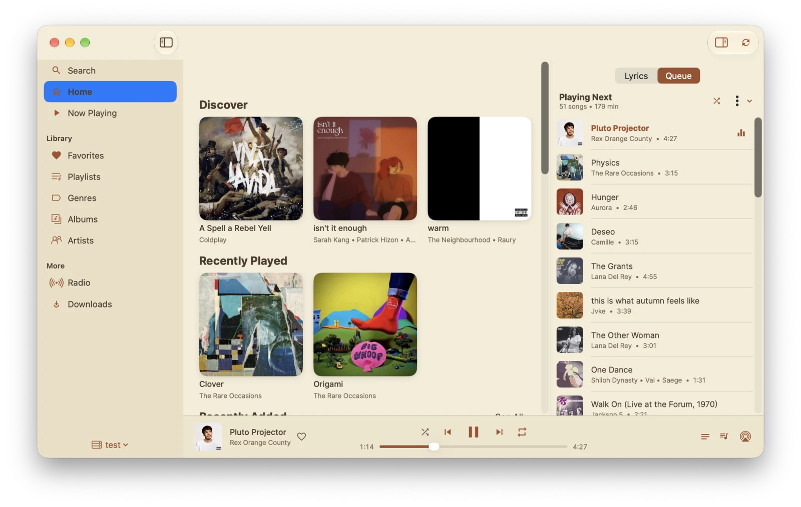 | 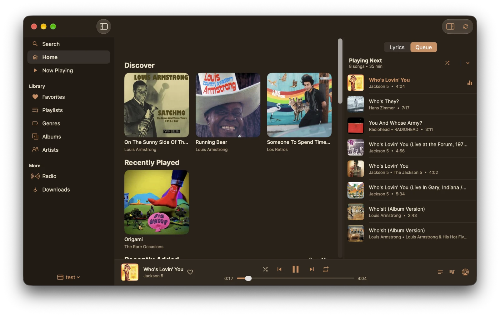 |

Now Playing in every theme

 

| Theme | Light | Dark |
|---|---|---|
| **Midnight** | 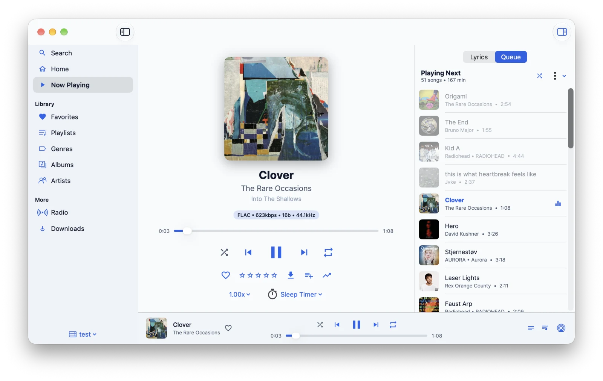 | 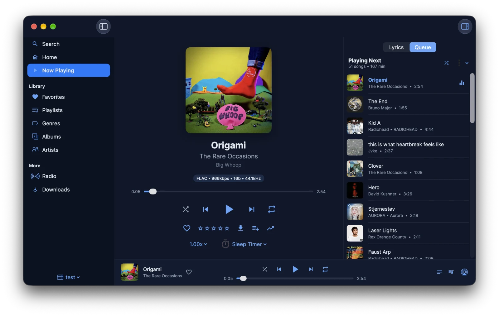 |
| **OLED** | 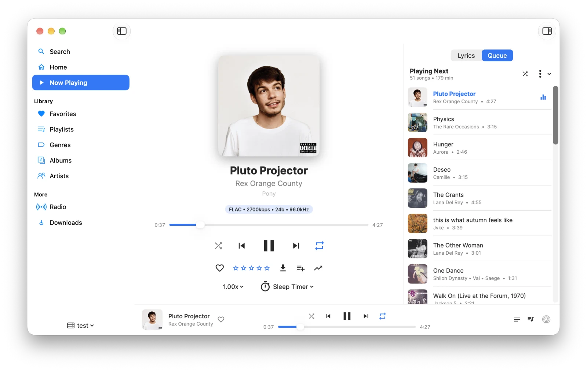 | 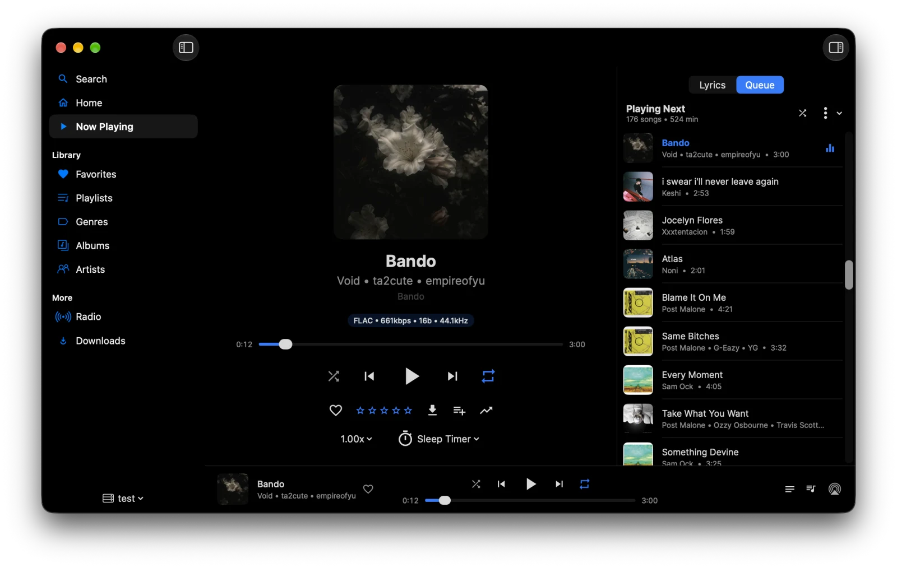 |
| **Sepia** | 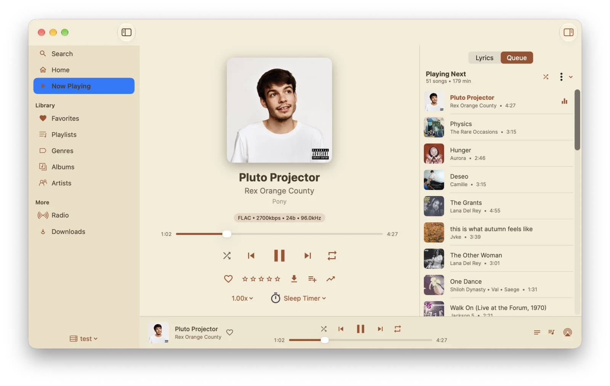 | 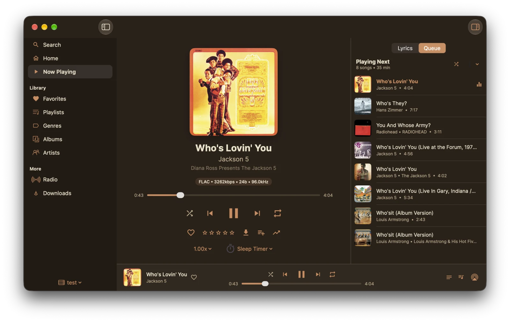 |

## Features

### Library and discovery
- **Subsonic integration.** Connect to one or more Subsonic, OpenSubsonic or Navidrome servers and switch between them. Supports token and legacy authentication, separate local and public addresses, custom request headers and client certificates (mTLS).
- **Home.** Up to 17 sections you can show, hide and reorder: Continue Listening, Discover, Recently Played, Recently Added, Most Played, Top Rated, starred tracks, albums and artists, Your Week, Flashback, Random Albums, pinned playlists, genres, newest podcasts and more.
- **Browse and search.** Artists, albums, genres, playlists, music folders and multiple libraries, each with its own detail page, and search across your whole library.
- **Favorites and ratings.** Star songs, albums and artists, rate tracks, and keep your starred songs one click away in the sidebar.
- **Instant Mix.** Start a mix from any song, album or artist using your server's similar-songs data.
- **Cache-first.** Every screen shows cached data immediately, then refreshes from the server, so the library opens instantly even on a large collection.

### Playback
- **Gapless playback** for lossless, MP3 and AAC files.
- **ReplayGain.** Track or album volume normalization with preamp and clipping prevention, when your files carry the tags.
- **Equalizer.** A built-in 10-band equalizer, or an AutoEQ parametric profile for your headphones.
- **Queue.** Reorder, remove, shuffle and save the queue as a playlist. The queue syncs with your server, so you can pick up where you left off on another device.
- **Lyrics.** Synced lyrics that follow the song, with an adjustable timing offset, plus plain lyrics.
- **Transcoding.** Choose a streaming format and bitrate, with separate settings for constrained networks such as Low Data Mode and hotspots (requires server support).
- **Playback speed, a sleep timer with fade-out, and scrobbling** to Last.fm or ListenBrainz through your server.

### Playlists, podcasts and radio
- **Playlists.** Create, edit, reorder and pin playlists.
- **Podcasts.** Browse channels and play episodes, if your server supports podcasts.
- **Internet radio.** Play your server's radio stations, or search for stations and save them on your Mac, even without server support.
- **Shares.** Create and manage share links for tracks, albums and playlists.

### Offline
- **Downloads.** Download songs, albums and playlists for offline listening, optionally transcoded to save space.
- **Keep Synced playlists** that update their downloads automatically.
- **Offline mode.** When your server can't be reached, Tempus opens with your cached library and downloads, and reconnects on its own when the server is back.

### Built for the Mac
- **Native SwiftUI interface** with a customizable sidebar, a player bar, a full Now Playing view, and a lyrics and queue inspector. Colors follow your system accent color in light and dark mode.
- **Menu bar mini player** and a **Dock menu** to control playback without switching windows.
- **Media keys, Control Center and the Lock Screen** through Now Playing integration.
- **AirPlay** to speakers and TVs, straight from the player bar.
- **Shortcuts actions** for play/pause and next and previous track.
- **Automatic updates** through [Sparkle](https://sparkle-project.org), with an optional beta channel.
- **Sandboxed**, with only the network access it needs.

### Keyboard shortcuts

| Action | Shortcut |
|---|---|
| Play / pause | <kbd>Space</kbd> |
| Next / previous track | <kbd>⌘</kbd> <kbd>→</kbd> / <kbd>⌘</kbd> <kbd>←</kbd> |
| Skip forward / back 10 seconds | <kbd>⌥</kbd> <kbd>⌘</kbd> <kbd>→</kbd> / <kbd>⌥</kbd> <kbd>⌘</kbd> <kbd>←</kbd> |
| Stop | <kbd>⌘</kbd> <kbd>.</kbd> |
| Shuffle / repeat | <kbd>⌥</kbd> <kbd>⌘</kbd> <kbd>S</kbd> / <kbd>⌥</kbd> <kbd>⌘</kbd> <kbd>R</kbd> |
| Star the current track | <kbd>⌘</kbd> <kbd>L</kbd> |
| Search | <kbd>⌘</kbd> <kbd>F</kbd> |
| Now Playing | <kbd>⌘</kbd> <kbd>0</kbd> |
| Sidebar items | <kbd>⌘</kbd> <kbd>1</kbd> … <kbd>⌘</kbd> <kbd>9</kbd> |
| Back | <kbd>⌘</kbd> <kbd>[</kbd> |

## Installation

Requires **macOS 15 Sequoia or newer**, on Apple silicon or Intel.

1. Download the latest `Tempus-<version>-macOS.zip` from [Releases](https://github.com/Unrefundable/Tempus-For-Mac/releases) and unzip it.
2. Move **Tempus.app** to your Applications folder.
3. Open Tempus. Beta builds aren't notarized yet, so macOS blocks the app the first time. Go to **System Settings › Privacy & Security** and click **Open Anyway**.
4. Enter your server's address, username and password, and start listening.

From then on, Tempus keeps itself up to date. To get pre-releases too, turn on **Settings › Updates › Get beta updates**. To check right away, choose **Tempus › Check for Updates…**

## How it works

Tempus talks to your server over the Subsonic REST API and uses OpenSubsonic extensions when the server offers them. Library data is cached in a local SQLite database, so screens draw immediately and stay available offline. Audio streams directly from your server, or plays from downloaded files, through a gapless streaming engine. Server passwords, tokens and client certificates are stored only in the macOS Keychain, tied to the server they belong to.

## License

Tempus for macOS is released under the [GNU General Public License v3.0](LICENSE), the same license as upstream Tempus, because it is a derivative work of it. You're free to use, modify and distribute it under the terms of the license.

## Credits

- [Tempus](https://github.com/eddyizm/tempus) by [eddyizm](https://github.com/eddyizm) and contributors, the Android app this port is based on.
- [Tempo](https://github.com/CappielloAntonio/tempo) by [CappielloAntonio](https://github.com/CappielloAntonio), the project Tempus was forked from.
- [SeattleGuy](https://github.com/SeattleGuy) for the Tempus logo design. The icons, illustrations and app icon are upstream Tempus's drawables, converted to SVG.
- [Inter](https://github.com/rsms/inter) by The Inter Project Authors (SIL Open Font License 1.1), the typeface Tempus uses. Its license ships with the fonts in `TempusKit/Sources/DesignSystem/Resources/Fonts/OFL.txt`.
- [AudioStreaming](https://github.com/dimitris-c/AudioStreaming) (MIT) for audio playback. A patched copy lives in `TempusMac/Vendor/AudioStreaming`, and its `TEMPUS-PATCHES.md` lists the changes.
- [Amperfy](https://github.com/BLeeEZ/amperfy) (GPL-3.0), whose player served as a reference for wiring AudioStreaming, the equalizer and ReplayGain.
- [GRDB](https://github.com/groue/GRDB.swift) (MIT) for the local database, [Nuke](https://github.com/kean/Nuke) (MIT) for artwork loading, and [Sparkle](https://sparkle-project.org) (MIT) for app updates.
